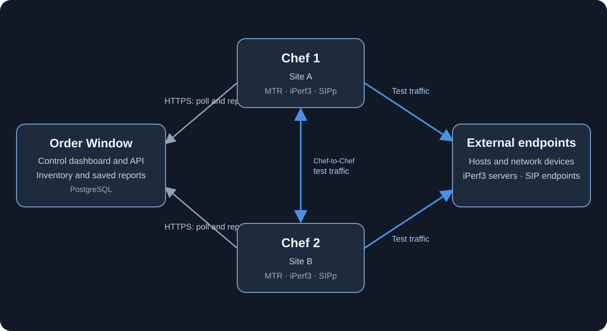

# brgrByte

**Run network tests from multiple sites. Collect results in one dashboard.**

brgrByte is a self-hosted dashboard and API that coordinates site agents. Agents run established network tools and send their reports back to the dashboard.

> **Project status:** Live container execution and Raspberry Pi/ARM64 deployments have not been validated. Test in a lab before production use. See the [roadmap](docs/ROADMAP.md).

## What you can test

| Tool | Use |
| --- | --- |
| **Ping** | ICMP replies and round-trip time (1–10 probes). |
| **Traceroute** | Numeric UDP route, up to 30 hops. |
| **DNS (dig)** | Query a DNS server for a selected record type. |
| **MTR** | Per-hop latency and packet-loss reports. |
| **Nmap** | TCP connect scans of 1–100 selected ports on one host. |
| **iPerf3** | TCP throughput to an existing or temporary receiver. Managed tests save both reports. |
| **SIPp** | Bounded SIP call-load tests over UDP; signaling only, no RTP media measurements. |

brgrByte also includes agent and site inventory, role-based access, credential provisioning and revocation, and saved test sessions. A report does not prove that a destination is reachable: firewalls and rate limits can affect results. Only test systems you are authorized to probe.

## How it works



The dashboard coordinates tests and stores reports. Agents send test traffic directly to destinations; they can run in the provided Linux container or as a native Debian service.

## Get started

Install Python 3.11+ and Docker with Compose, clone this repository, then run the launcher from its root:

```powershell
# Windows
py -3 start.py
```

```sh
# Linux
python3 start.py
```

Choose **dashboard**, **agent**, or **both** when prompted. You can also pass `--mode dashboard`, `--mode agent`, or `--mode both`. First-time setup asks you to create an administrator account. The launcher can use it to register an agent with a unique credential and does not overwrite existing configuration.

Windows agents run in Docker Desktop's Linux environment, not on the Windows network stack. Host networking must be enabled, and raw ICMP may be unavailable. Remote agents need a trusted HTTPS API endpoint.

For setup instructions and limitations, see the **[getting started guide](docs/GETTING_STARTED.md)**.

## Run tests

In **Build & bite**, choose tools (patties), configure them (toppings), and run the tests. Each tool is a separate test from one source agent to one destination. **Take a bite** opens statuses and reports. The Path and Service combos are presets; choosing one replaces your current tools and settings.

## Documentation

- [Getting started](docs/GETTING_STARTED.md) · [Agent installation](docs/AGENT_INSTALLATION.md)
- [Deployment](docs/DEPLOYMENT.md) · [Network requirements](docs/NETWORK_REQUIREMENTS.md) · [Security](docs/SECURITY.md)
- [Architecture](docs/ARCHITECTURE.md) · [API reference](docs/API.md) · [Roadmap](docs/ROADMAP.md)
- [Testing guide](docs/TESTING_GUIDE.md) · [Contributing](CONTRIBUTING.md)

brgrByte was previously named BrgrOps, Pathwise, and NetworkPath. Existing `NETWORKPATH_` environment variables, agent paths, container names, and database volume identifiers remain unchanged for compatibility.

## License

brgrByte's code is licensed under [GPL-2.0-only](LICENSE). The network tools and dependencies have separate licenses; brgrByte's license does not replace them. Check the terms for the exact versions you use.

**Nmap redistribution is not cleared.** The agent image pins Debian's Nmap `7.95+dfsg-3`. Nmap's terms include additional conditions, so GPLv2 alone does not establish that distributing an image containing Nmap is permitted. Get written clarification or permission from the Nmap Project, or consult qualified counsel, before distributing such an image. Review other dependency licenses separately. This is not legal advice.

See [third-party notices](third-party-notices/README.md) for a reference copy of the Nmap 7.95 source package license; it may not apply to other versions.
