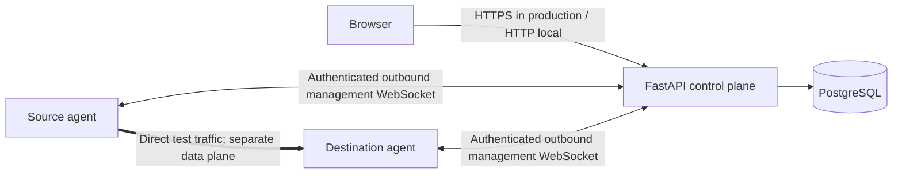
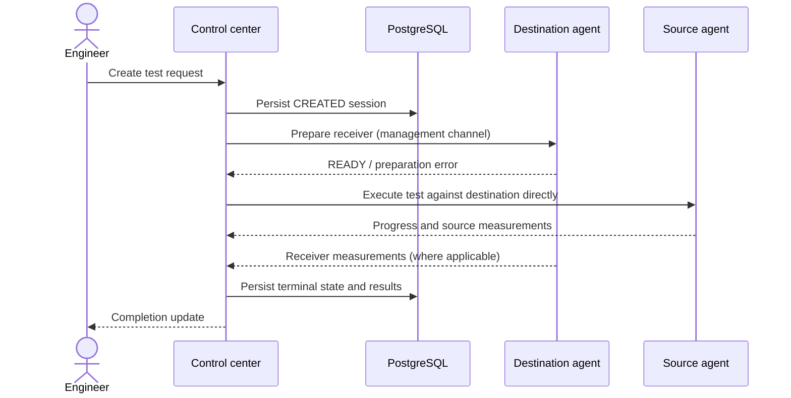
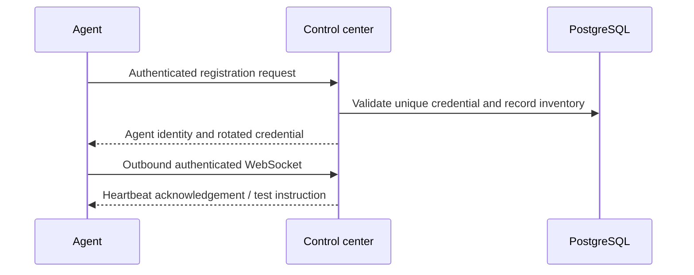

# Architecture

## Components and trust boundaries

The browser uses a JWT-authenticated REST API. The control center owns inventory, coordination, and result persistence. Agents are intended to initiate authenticated outbound management connections; agent-to-agent test packets must not be proxied through the control center. Agent transport and test execution are not implemented in the foundation release.

## Test orchestration target

Persisted test states are constrained to `CREATED`, `PREPARING`, `READY`, `RUNNING`, `COMPLETED`, `FAILED`, `CANCELLED`, and `TIMEOUT`. Dispatch success alone must never mean a test succeeded.

## Agent registration target

Registration, credential issuance/rotation, WebSockets, and heartbeat processing are future work. The initial schema defines inventory fields but does not yet provision agent credentials.
