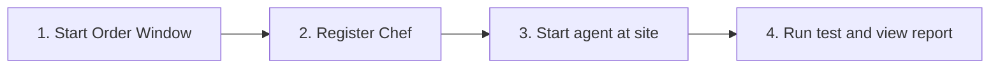

# Getting started

This guide uses the launcher to start the **Order Window** (the dashboard), **Chefs** (site agents), or both on one workstation, then runs an MTR test. A Chef can also run iPerf3, SIPp, Nmap, ping, traceroute, and DNS queries.



## Before you begin

- Python 3.11+, Docker with the Compose plugin, and a copy of this repository on each workstation. Docker Desktop with Linux containers supports Windows; Docker Engine supports Linux.
- A browser on the dashboard host, and network access from the agent environment to the destination. One workstation can run both components.
- For a remote site agent, a trusted HTTPS reverse proxy in front of the API, reachable from that host. The agent rejects HTTP except for `localhost`, `127.0.0.1`, or `::1` on the agent's own host. The repository does not configure the reverse proxy for you.
- Permission to test the destination. iPerf3 can saturate links, and SIPp can generate real calls.

The agent container uses Linux host networking, `NET_RAW`, and a setuid MTR packet helper. Rootless Docker, user namespaces, and restrictive host policies may prevent it from working. On Windows, use Docker Desktop 4.34 or later and enable **host networking** under Settings > Resources > Network, then restart Docker Desktop. Host networking is incompatible with Enhanced Container Isolation. The agent runs in Docker Desktop's Linux environment: its routes, addresses, and reachability may differ from Windows, and Docker Desktop host networking does not support protocols below TCP/UDP, so raw ICMP/MTR may fail. Use a native Linux agent for host-level ICMP measurements. Windows and ARM64 agent deployments have not yet been validated here.

## Quick launch

From the repository root:

```powershell
# Windows
py -3 start.py
```

```sh
# Linux
python3 start.py
```

Choose **Order Window (dashboard)**, **Chef (site agent)**, or **both**. The first Order Window launch asks you to choose an administrator username and password and generates database and signing secrets in the root `.env`. For **both**, the launcher starts the Order Window, then uses that new administrator account to register a Chef and save its unique credential. If the Order Window was already configured, enter its existing administrator username and password when prompted. For **Chef**, enter the Order Window API URL and administrator credentials; the launcher registers a site agent for you. The launcher asks for a Chef name, offering a unique default.

The combined mode defaults to `http://localhost:8000`; on Windows this requires Docker Desktop host networking to be enabled. Remote agent URLs require trusted HTTPS, and the launcher and agent container must both trust its certificate. No shared default passwords or agent credentials are installed.

Run the same command again to reuse existing configuration, or choose directly with `--mode dashboard`, `--mode agent`, or `--mode both`. The launcher does not overwrite existing `.env` files; edit them yourself to change settings. It waits for the dashboard services and checks for an authenticated agent connection, reporting errors if startup or connection fails. It does not verify that a network test succeeds.

On Linux, newly generated files are created with owner-only permissions. On Windows, access follows the directory's inherited ACLs: restrict access to the repository and both `.env` files. Docker administrators can also inspect container environment variables. If dashboard browser access is remote, set the API URL and CORS origins as described below before launching.

## Manual Order Window configuration

From the repository root, copy `.env.example` to `.env`:

```powershell
# Windows PowerShell
Copy-Item .env.example .env
```

```sh
# Linux shell
cp .env.example .env
```

Edit `.env` and set unique values for `POSTGRES_PASSWORD`, `BRGRBYTE_JWT_SECRET_KEY` (at least 32 characters), and `BRGRBYTE_ADMIN_PASSWORD` (at least 12 characters). The example values are placeholders. Keep `.env` private and never commit it. The database password should be URL-safe because it is embedded in the database connection URL.

For a browser accessing the dashboard from another machine, configure `VITE_API_BASE_URL` as the browser-reachable API URL and set `BRGRBYTE_CORS_ORIGINS` to the exact dashboard origin before building the frontend. The default API URL is `http://localhost:8000`, which points to the browser's own machine. Use HTTPS for non-local access; see [deployment](DEPLOYMENT.md).

Start the services from the repository root:

```sh
docker compose up -d --build
```

Open [http://localhost:8080](http://localhost:8080) on the control-center host and sign in with `BRGRBYTE_ADMIN_USERNAME` and `BRGRBYTE_ADMIN_PASSWORD` from `.env`. The API's interactive documentation is at [http://localhost:8000/docs](http://localhost:8000/docs), and readiness is at [http://localhost:8000/health/ready](http://localhost:8000/health/ready).

If startup fails, inspect `docker compose logs api` and `docker compose logs db`. The administrator is created only when the configured username does not already exist; changing the bootstrap password does not reset an existing account.

## Register a Chef manually

1. Sign in to the Order Window as an administrator. Optionally add a location on the **Sites** page.
2. On **Chefs**, enter a unique name, optionally select the site, and choose **Add Chef**.
3. Copy the credential immediately. It is shown only once. Each agent needs its own credential; treat it as a secret.

If a credential is lost or compromised, revoke the Chef from the Order Window and register a new identity. Revocation cancels associated queued or running jobs but cannot stop a process already running on the host.

## Manual agent configuration

On a Linux site host, change to the repository's `agent` directory and create a private configuration file (the launcher does this for you):

```sh
cd agent
umask 077
touch .env
chmod 600 .env
```

Edit `agent/.env` with a text editor, replacing the example values with your API URL and the credential copied from the dashboard:

```text
BRGRBYTE_URL=https://control-center.example
BRGRBYTE_AGENT_CREDENTIAL=<one-time-agent-credential>
```

The URL must reach the API, not merely the frontend, and its certificate must be trusted by the agent container. For a control center and agent sharing the same native Linux host, `http://localhost:8000` can be used for local development. Do not put credentials in the repository or shell history.

Build and start the agent:

```sh
docker compose up -d --build
docker compose logs -f agent
```

Refresh **Chefs** in the Order Window. The site agent should appear online and advertise `mtr`, `iperf3`, `sipp`, `nmap`, `ping`, `traceroute`, and `dns`. The image installs those packages during the build; the site host does not need separate installations. Rebuild and restart an existing agent image to add the new tools.

To check MTR's local probe permissions:

```sh
docker compose run --rm --no-deps --entrypoint mtr agent \
  --report --json -n --report-cycles 1 --max-ttl 2 127.0.0.1
```

The JSON should show the `127.0.0.1` hop with less than 100% loss. This verifies a local probe, not connectivity to a remote destination. See [agent installation](AGENT_INSTALLATION.md) for private CA certificates, host permissions, updates, and native Debian installation.

## Run a test and view its report

1. Open **Build & bite** and choose **Build your burger**. Select **MTR** as a patty and choose an online Chef that supports every selected tool.
2. Enter an authorized destination hostname or IP. MTR seasoning starts **Plain** at the default 10 probe cycles; open it to customize, then choose **Place order**.
3. Choose **Take a bite** to view recent test statuses and reports. Refresh the dashboard to update them, and expand **View raw JSON** for the tool output.

Select multiple patties to queue separate tests against the same Chef and destination, or choose **Path combo** (ping, MTR, traceroute) or **Service combo** (ping, Nmap). Each selected patty has its own seasoning card: **Plain** means the tool's defaults; customize its settings or reset to Plain. Choosing a combo replaces the selected patties and resets seasonings. The Chef must support every selected tool. Tests have individual reports and are not an atomic order: if some requests fail, the Order Window lists confirmed and unconfirmed tools. Check recent tests before retrying an unconfirmed request, because a lost response may have queued it. The bite view shows the latest 100 tests across all burgers, not a grouped order. Chefs execute jobs one at a time, and queued jobs expire after five minutes, so large or slow orders may time out. iPerf3 and SIPp require suitable endpoints and can generate significant traffic.

`COMPLETED` for MTR means a report was collected; inspect the hops and loss rather than assuming the destination is reachable. A queued job can time out if the agent does not claim it, and an executing job can time out if its result is not delivered.

To try the other tools:

- **iPerf3 TCP:** Select an existing external iPerf3 server or a second online agent as receiver. Enter the receiver's reachable IP or hostname and TCP port. For a managed receiver, allow the chosen port between hosts. The temporary server is unauthenticated, so restrict access to trusted test hosts.
- **SIPp basic UAC:** Enter an unauthenticated SIP endpoint, UDP port, request URI user, call count, rate, and concurrency. The test stops after 80 seconds; choose settings that allow calls to finish. It tests signaling, not RTP audio.
- **Nmap TCP ports:** Enter one authorized hostname or IP and 1–100 distinct, comma-separated TCP port numbers. This uses TCP connect scanning without service-version detection; displayed service names are guesses based on port numbers.
- **Ping:** Select a destination and 1–10 ICMP probes. No replies is reported as a failed test, with available output retained.
- **Traceroute UDP:** Trace a single host with up to 30 hops. A collected report does not mean the destination was reached; examine the output for missing replies.
- **DNS:** Select the DNS patty, enter the DNS name in the shared destination field, and choose a DNS server IP and record type. The default server is `8.8.8.8` and the default type is `A`. The server is used only for the DNS test; other selected tools use the agent's system resolver. A successful `NOERROR` response can contain no answers, or contain CNAMEs without the requested record, so inspect the returned output.

See [network requirements](NETWORK_REQUIREMENTS.md) and [agent installation](AGENT_INSTALLATION.md) for firewall rules and tool-specific limitations.

## Stop the services

Run `docker compose down` in the **agent** directory to stop the site agent. Run the same command from the **repository root** to stop the control center. The control center's PostgreSQL named volume remains in place so inventory and reports persist.
